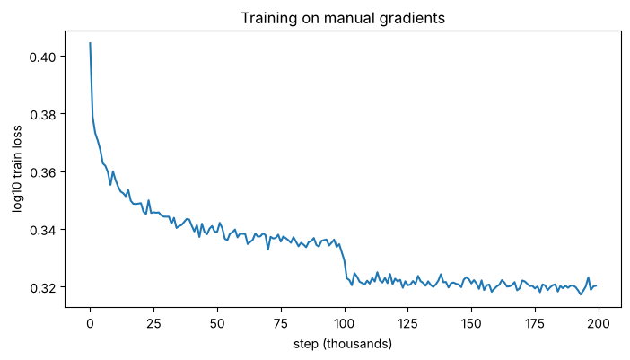

# Becoming a backprop ninja

Backpropagation written out by hand, tensor by tensor, for a character-level MLP language model with
BatchNorm. No `loss.backward()`. Every gradient is derived on paper, implemented in PyTorch, checked
against autograd, and then used on its own to train the network.

This is the third step in a series built on Karpathy's *Neural Networks: Zero to Hero* (lecture 4):

1. [`designing-bigram`](https://github.com/tusharchandra19/designing-bigram): count-based and neural bigram models
2. [`mlp-language-model`](https://github.com/tusharchandra19/mlp-language-model): the Bengio et al. (2003) MLP
3. **`backprop-ninja`**: the same kind of MLP, with BatchNorm, trained on hand-written gradients

| File | What it is |
|---|---|
| [`backprop_ninja.ipynb`](backprop_ninja.ipynb) | The notebook: four exercises, commented and executed |
| `data/names.txt` | 32,033 names (from [karpathy/makemore](https://github.com/karpathy/makemore)) |
| `assets/` | Training-loss plot |

## Results

Training with **only** the manual backward pass (200k steps, batch 32, lr 0.1 → 0.01 at 100k):

| | Train loss | Val loss |
|---|---|---|
| Manual backprop (this repo) | **2.0696** | **2.1102** |
| Karpathy's reference, same recipe | 2.0719 | 2.1162 |

Gradient check, manual vs `torch.autograd`, on one batch of the 200-unit network:

| Parameter | Shape | Max abs. difference |
|---|---|---|
| `C` | 27 × 10 | 2.2e-8 |
| `W1` | 30 × 200 | 1.1e-8 |
| `b1` | 200 | 5.6e-9 |
| `W2` | 200 × 27 | 2.2e-8 |
| `b2` | 27 | 7.5e-9 |
| `bngain` | 1 × 200 | 3.7e-9 |
| `bnbias` | 1 × 200 | 7.5e-9 |



The step at 100k is the learning-rate drop from 0.1 to 0.01.

Samples: `harli`, `jari`, `reetlanna`, `kaleigh`, `quinn`, `nellara`, `kaellissa`, `jarynix`.

## The network

```
Xb (32,3) ─► C[Xb] (32,3,10) ─► view (32,30) ─► @W1+b1 (32,200) ─► BatchNorm ─► tanh ─► @W2+b2 (32,27) ─► cross-entropy
```

## Exercise 1: backprop through every node

The forward pass is split into about 20 small operations, so each one has a local derivative that is
easy to write down. Going backwards, each gradient is **local derivative × upstream gradient**,
summed over every place the tensor is used. The patterns that come up repeatedly:

| Forward | Backward |
|---|---|
| `c = a * b`, with `b` broadcast (e.g. `(32,1)` over `(32,27)`) | `da = b * dc`, `db = (a * dc).sum(dim, keepdim=True)`: broadcast forward ⇔ sum backward |
| `s = a.sum(1, keepdim=True)` | `da = torch.ones_like(a) * ds`: sum forward ⇔ broadcast backward |
| `y = x @ W + b` | `dx = dy @ W.T`, `dW = x.T @ dy`, `db = dy.sum(0)`. Shapes force the transposes. |
| `h = tanh(z)` | `dz = (1 - h**2) * dh` |
| `y = log(x)`, `exp(x)`, `x**k` | `dx = dy / x`, `dx = exp(x) * dy`, `dx = k * x**(k-1) * dy` |
| `m = x.max(1)` | gradient goes only to the argmax position (one-hot mask) |
| `emb = C[X]` (lookup) | scatter-add: `dC[X[i,j]] += demb[i,j]` |
| a tensor used twice (`counts`, `bndiff`, `hprebn`) | add up the gradients from both uses |

Two details worth noticing:

- **`dlogit_maxes` is about 0.** Softmax is shift-invariant, so subtracting the row max changes
  nothing about the loss. It exists only for numerical stability, so its gradient is zero up to
  round-off.
- **Exact vs approximate.** Everything from the loss down to `W2`/`b2` matches autograd bit for bit.
  From `hpreact` down it matches to ~1e-9: the maths is the same, but PyTorch evaluates it in a
  different order.

## Exercise 2: cross-entropy backward in one line

For one example with logits $\ell$, $p = \mathrm{softmax}(\ell)$ and target $y$:

$$L = -\log p_y = -\ell_y + \log\sum_k e^{\ell_k}
\quad\Rightarrow\quad
\frac{\partial L}{\partial \ell_j} = -\mathbb{1}[j=y] + \frac{e^{\ell_j}}{\sum_k e^{\ell_k}} = p_j - \mathbb{1}[j=y]$$

Averaged over a batch of $n$:

```python
dlogits = (F.softmax(logits, 1) - F.one_hot(Yb, 27)) / n
```

This replaces eight backward steps from Exercise 1. In each row, the correct class is pushed up by
$1 - p_y$ and every wrong class is pulled down by its own probability, so the row sums to zero. The
gradient vanishes only when the model puts all its probability on the right answer.

## Exercise 3: BatchNorm backward in one line

Forward, per hidden unit (one column of the batch), with Bessel's correction as in the notebook:

$$\mu = \tfrac1n\sum_i x_i,\qquad \sigma^2 = \tfrac{1}{n-1}\sum_i (x_i-\mu)^2,\qquad
\hat x_i = \frac{x_i-\mu}{\sqrt{\sigma^2+\epsilon}},\qquad y_i = \gamma\hat x_i + \beta$$

Every $y_j$ depends on every $x_i$ in the column, through $\mu$ and $\sigma^2$. Write
$s = (\sigma^2+\epsilon)^{-1/2}$ and $g_j = \partial L/\partial y_j$, so
$\partial L/\partial \hat x_j = \gamma g_j$. Then:

- through the mean: $\partial(x_j-\mu)/\partial x_i = \delta_{ij} - \tfrac1n$
- through the variance: $\partial\sigma^2/\partial x_i = \tfrac{2}{n-1}(x_i-\mu)$. The $\mu$ term
  drops out because $\sum_j (x_j-\mu)=0$.
- so $\partial s/\partial x_i = -\tfrac12 s^3 \cdot \tfrac{2}{n-1}(x_i-\mu) = -\tfrac{s^2}{n-1}\hat x_i$

Putting these together:

$$\frac{\partial \hat x_j}{\partial x_i} = s\Big(\delta_{ij} - \frac1n\Big) - \frac{s}{n-1}\,\hat x_i\hat x_j$$

$$\frac{\partial L}{\partial x_i} = \sum_j \gamma g_j \frac{\partial \hat x_j}{\partial x_i}
= \frac{\gamma s}{n}\Big(n\,g_i - \sum_j g_j - \frac{n}{n-1}\,\hat x_i\sum_j g_j\hat x_j\Big)$$

```python
dhprebn = bngain*bnvar_inv/n * (n*dhpreact - dhpreact.sum(0) - n/(n-1)*bnraw*(dhpreact*bnraw).sum(0))
```

The three terms are the direct path, the path through the mean (removes the column average of the
gradient), and the path through the variance (removes the component along $\hat x$). The result is a
gradient that is zero-mean and (up to $\epsilon$) orthogonal to $\hat x$ in every column. That's a signature of
normalisation: shifting or scaling a whole column of inputs leaves the output unchanged, so the
gradient can't point in those directions.

## Exercise 4: training on the manual gradients

The backward pass is collected into `manual_backward()`: cross-entropy from Exercise 2, BatchNorm
from Exercise 3, and the matmul, tanh and embedding steps from Exercise 1. After one gradient check
against autograd, the training loop runs entirely under `torch.no_grad()` and updates the parameters
with these gradients alone.

## What changed from the Colab version

The repo has two commits, so `git diff` / the GitHub history shows exactly what changed:

1. **`Backprop ninja: notebook as written in Colab`**: the notebook exactly as exported.
2. **Second commit**: comments, and Exercise 4 finished.
   - **Exercise 4 now trains on the manual gradients.** In the original, the update still used
     PyTorch's gradients (`p.data += -lr * p.grad`; the `grad` line was commented out), and the
     debug `if i >= 100: break` stopped training after 101 steps. That's why the original notebook
     showed val 2.68 and samples like `carmahxqao`. The loop now uses the manual gradients, runs all
     200k steps under `torch.no_grad()`, and no longer calls `loss.backward()`.
   - The backward code is in `forward()` / `manual_backward()` functions, plus an explicit gradient
     check cell. The check uses its own random generator, so the training run sees the same batches.
   - `dC` in the training loop uses `index_add_` (the same scatter-add, vectorised) instead of a
     Python double loop. Exercise 1 keeps the loop, where it is clearer.
   - Exercise 1: a derivation comment on every step; debug `print`s removed; the hard-coded
     `view(32, 3, 10)` replaced with `view(emb.shape)`.
   - Markdown explanations between exercises, a training-loss plot, and the data loaded from
     `data/names.txt` instead of `wget`.

All of your exercise solutions are unchanged.

## Running locally

```bash
pip install -r requirements.txt
jupyter notebook backprop_ninja.ipynb
```

The full notebook runs in about 3 minutes on CPU, and it is fully seeded, so results
reproduce.

## Credits

Exercise structure, network and data from Andrej Karpathy's
[makemore](https://github.com/karpathy/makemore) / *Neural Networks: Zero to Hero*, lecture 4.
BatchNorm: Ioffe & Szegedy, [*Batch Normalization*](https://arxiv.org/abs/1502.03167) (2015).
